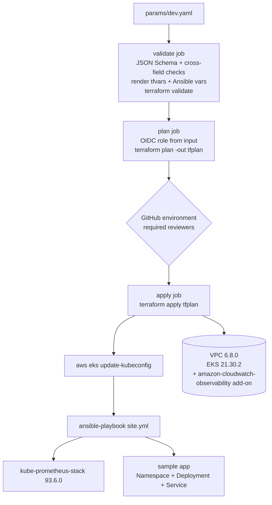

# Golden path environment provisioner

A template for standing up a greenfield environment (VPC, EKS, observability,
sample app) from **one parameter file**, using GitHub Actions, Terraform,
Ansible and Kubernetes manifests.

> **Status: nothing in this repo has ever run in a real AWS account or
> against a real cluster.** This is the minimum that stands up and
> validates. What is actually exercised:
>
> | Stage | How it is checked | Run for real? |
> |---|---|---|
> | Parameter file + JSON Schema + validator | 34 pytest tests, including 18 rejected inputs | yes, locally and in CI |
> | Renderer (tfvars + Ansible vars) | pytest; output keys must match `variables.tf` and the playbook | yes |
> | Terraform root (VPC + EKS + observability add-on) | `fmt -check`, `init -backend=false`, `validate` | **static only**; never planned or applied |
> | Ansible "prepare" play (render manifests and chart values) | `ansible-lint`, `--syntax-check`, `--check` | check mode only |
> | Ansible "cluster" play (Helm + k8s apply) | `ansible-lint`, `--syntax-check` | **static only**; it needs a cluster |
> | Reusable workflow (validate, plan, apply) | `actionlint` plus structural pytest guards | **static only**; never called |
>
> Not built: remote state bucket bootstrap, the OIDC identity provider and
> IAM role, GitHub environment protection rules (repo settings), ingress or
> DNS for the app, and a teardown workflow.

## Problem

> Develop an end-to-end reusable workflow (GitHub Actions + Terraform +
> Ansible + Kubernetes manifests) that provisions a complete greenfield
> environment (VPC → EKS → observability → sample app) from a single
> parameter file, suitable as a company golden-path template.

Why it matters: when every team builds its own environment, each one ends
up with different networks, cluster settings and monitoring, and each takes
weeks. One reviewed template driven by a small parameter file gives every
team the same starting point, with the guardrails already in place.

## Flow



## Pieces

### 1. Parameter file and validator

`params/dev.yaml` is the only file a team edits.
`schema/environment.schema.json` (JSON Schema 2020-12, no extra properties
allowed) checks shape and formats. `golden/params.py` adds the rules a
schema can't express: `min <= desired <= max` nodes, real private CIDRs of
`/16` to `/20`, AZs inside the region, no `0.0.0.0/0` on the API endpoint,
and image tags that are not `:latest`. All problems are reported together.

```bash
python -m golden validate params/dev.yaml
```

### 2. Renderer

```bash
python -m golden render params/dev.yaml --out build
# build/dev/terraform.tfvars.json   inputs for terraform/
# build/dev/ansible-vars.json       extra vars for ansible/site.yml
# build/dev/meta.json               environment, region, cluster name for the workflow
```

Subnets are carved from the VPC CIDR (one private and one public per AZ).
A test fails if the tfvars keys and `terraform/variables.tf` drift apart.

### 3. Terraform root (`terraform/`)

- `terraform-aws-modules/vpc/aws` **6.8.0**: private and public subnets, one
  NAT gateway (cheap for dev; use one per AZ in prod).
- `terraform-aws-modules/eks/aws` **21.30.2**: managed node group, API
  endpoint limited to `api_allowed_cidrs`, and EKS add-ons including
  **`amazon-cloudwatch-observability`** (CloudWatch agent and Fluent Bit).
  The node role gets `CloudWatchAgentServerPolicy` so the agent can publish.
- `provider "aws"` with `allowed_account_ids`, so a plan against the wrong
  account fails.
- Partial `s3` backend with S3-native locking (`use_lockfile`), configured
  by the workflow. `.terraform.lock.hcl` is committed because this is a
  root (aws 6.73.0, tls, time, null, cloudinit; four platforms).

### 4. Ansible (`ansible/`)

`site.yml` has two plays on the control node:

- **prepare** (tag `prepare`): asserts the rendered vars, renders the
  sample app manifest and the kube-prometheus-stack values. This is what CI
  runs in `--check` mode, and the CI step fails if no task actually ran.
- **cluster** (tag `cluster`): `kubernetes.core.helm` installs
  kube-prometheus-stack **93.6.0**, and `kubernetes.core.k8s` applies the
  app. It needs a live cluster, so CI only lints and syntax-checks it.

The lessons from repo 17 apply: every module is FQCN, there is no
`failed_when: false`, and `host_key_checking = True` stays on. A pytest
guard checks all three.

### 5. Reusable workflow (`.github/workflows/provision.yml`)

`on: workflow_call` with inputs `params_file`, `environment`,
`aws_plan_role_arn`, `aws_role_arn`, `tf_state_bucket`.

- **validate:** render, `terraform validate`, upload `build/`.
- **plan:** `id-token: write`, assumes the read-only `aws_plan_role_arn`
  through GitHub OIDC (no stored keys), `terraform plan -lock=false -out
  tfplan`, uploads the plan. The plan skips the state lock because a
  read-only role can't write the S3 lock file; apply takes the lock and
  refuses the plan if the state changed after it was made.
- **apply:** runs in `environment: ${{ inputs.environment }}`. The gate is
  the **required reviewers** you configure on that GitHub environment.
  Assumes `aws_role_arn`, applies exactly the uploaded plan, gets a
  kubeconfig, runs the playbook.
- **concurrency:** the workflow uses the group
  `golden-path-provision-<environment>` with `cancel-in-progress: false`, so
  two runs for the same environment never overlap. A second run waits; if a
  third arrives, GitHub keeps only the newest pending one.

Terraform is downloaded in each job and checked against a pinned sha256.
Every action is pinned to a commit SHA that was checked against its tag.
The Helm and AWS CLIs come preinstalled on the GitHub runner image and are
not pinned.

A caller in another repo would look like this (not included here, because
it would try to reach AWS):

```yaml
jobs:
  dev:
    uses: zeinhaidara/50-golden-path-env-provisioner/.github/workflows/provision.yml@<commit-sha>
    with:
      params_file: params/dev.yaml
      environment: dev
      aws_plan_role_arn: arn:aws:iam::123456789012:role/golden-path-plan
      aws_role_arn: arn:aws:iam::123456789012:role/golden-path-deployer
      tf_state_bucket: tfstate-123456789012-eu-west-2
    permissions:
      contents: read
      id-token: write
```

### OIDC trust policy for the two roles (not built here)

The roles are not part of this repo. Each needs a trust policy on the GitHub
OIDC provider that checks both the audience and the subject. Because this is
a reusable workflow, the `sub` claim names the **caller** repository, not
this one. Use `StringEquals`, never a wildcard such as `repo:example-org/*`.

| Role | Job | `token.actions.githubusercontent.com:sub` must equal |
|---|---|---|
| plan (read-only) | `plan`, no GitHub environment | `repo:<org>/<caller-repo>:ref:refs/heads/main` (or `...:pull_request` if callers plan on PRs) |
| apply | `apply`, runs in `environment:` | `repo:<org>/<caller-repo>:environment:<environment>` |

A job that names a GitHub environment gets the environment form of `sub`,
so the apply role only trusts runs that passed that environment's
protection rules. Both roles also need
`token.actions.githubusercontent.com:aud` equal to `sts.amazonaws.com`.

```json
{
  "Version": "2012-10-17",
  "Statement": [
    {
      "Effect": "Allow",
      "Principal": {
        "Federated": "arn:aws:iam::123456789012:oidc-provider/token.actions.githubusercontent.com"
      },
      "Action": "sts:AssumeRoleWithWebIdentity",
      "Condition": {
        "StringEquals": {
          "token.actions.githubusercontent.com:aud": "sts.amazonaws.com",
          "token.actions.githubusercontent.com:sub": "repo:example-org/platform-envs:environment:dev"
        }
      }
    }
  ]
}
```

The plan role needs read access only (for example `ReadOnlyAccess` plus
`s3:GetObject` and `s3:ListBucket` on the state bucket). The apply role
needs the write permissions for VPC, EKS and IAM, plus write access to the
state object and its `.tflock` file. To also pin which workflow may assume a
role, GitHub can add `job_workflow_ref` to the `sub` claim through the
repository's OIDC subject customization; the condition then includes this
workflow's path and ref.

## Run the checks locally (same as CI)

```bash
python -m pip install -r requirements-dev.txt
actionlint                                   # v1.7.12, sha256 in ci.yml
python -m ruff check . && python -m ruff format --check .
python -m pytest -q
python -m golden render params/dev.yaml --out build
(cd terraform && terraform fmt -check && terraform init -backend=false -lockfile=readonly && terraform validate)
yamllint .
ansible-galaxy collection install -r ansible/requirements.yml
cd ansible
ansible-lint
ansible-playbook -i inventory.ini site.yml --syntax-check -e @../build/dev/ansible-vars.json
ansible-playbook -i inventory.ini site.yml --check --diff --skip-tags cluster -e @../build/dev/ansible-vars.json
```

Ansible runs on Linux or macOS only. On Windows, use WSL or a container.

## Limits

- Never planned, applied or run against a cluster. The cluster play and
  the workflow's plan/apply jobs are checked statically only.
- Single NAT gateway and a public (CIDR-restricted) EKS API endpoint, to
  keep the template small. A private endpoint needs a runner inside the VPC.
- The plan artifact can contain sensitive values; it is kept for one day.
  A real setup might encrypt it or plan and apply in one approved job.
- Grafana is ClusterIP only; there is no ingress, DNS or TLS for anything.
- No teardown workflow, no drift detection, no cost estimate.

## Security notes

- No AWS keys anywhere: plan and apply assume a role through OIDC, and only
  those two jobs get `id-token: write`. Plan uses its own read-only role, so
  code that runs during plan can't change the account.
- One run per environment at a time (workflow `concurrency` group).
- Apply needs a human approval on the protected GitHub environment and
  applies only the reviewed plan file.
- `allowed_account_ids` stops a run against the wrong account.
- Workflow inputs reach shell steps through `env:`, not inline `${{ }}`,
  to avoid script injection.
- The sample app runs as non-root, with dropped capabilities and a
  RuntimeDefault seccomp profile.
